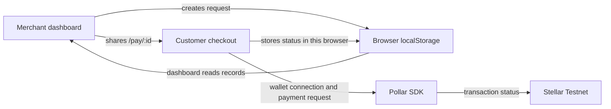

# PayLink

**Pay. Share. Get Paid.** PayLink helps independent businesses and freelancers request a specific stablecoin amount with a simple checkout link.

## What it does

Create a USDC payment request, share its URL, let a customer connect a Pollar wallet, and show the transaction status on Stellar Testnet. It is designed to shorten the payment request and reconciliation loop for small businesses.

## Stack and architecture

React, Vite, TypeScript, React Router, Lucide, `@pollar/core` and `@pollar/react`.



Pollar supplies wallet connection and transaction submission. PayLink calls the documented `sendPayment()` method with a Stellar issued USDC asset, handles the SDK's typed `success`, `pending`, `error`, and `cosign_pending` outcomes, then uses `getTxStatus()` to decide whether the invoice can be marked paid. These methods and response types were checked against `@pollar/core` 0.12.0 and `@pollar/react` 0.12.0. The exact issuer is supplied by the merchant's Pollar app configuration; the app does not guess it. No secret key is used in the browser. The SDK is validated, but a real testnet transaction still needs to be completed with valid app configuration and wallet credentials.

## Setup

```bash
npm install
cp .env.example .env
npm run dev
```

Set `VITE_POLLAR_API_KEY` to the Pollar publishable key for your testnet app and `VITE_STELLAR_USDC_ISSUER` to the exact USDC issuer enabled for that app. These `VITE_` values are shipped to the browser; never use them for secrets. The supported asset is currently USDC only.

## Build and preview

```bash
npm run build
npm run preview
```

## Demo and limitations

Create an invoice from the dashboard, copy its `/pay/:id` URL and open it in the same browser profile. Connect a customer wallet, initiate a payment, then check the transaction and dashboard status. Do not present a successful on-chain payment unless Pollar returns a confirmed success status.

Invoices live in browser localStorage. A URL opened in a different browser or device does not have the invoice record, and records are user-editable rather than an authoritative ledger. An unresolved submitted transaction blocks another attempt in that browser to reduce accidental duplicates. There is no backend, shared merchant identity, trusted webhook verification, or cross-device persistence; this is not production settlement infrastructure. No real testnet transaction has been verified as part of this source audit.

### Three minute demo pitch

Small businesses often have to send wallet addresses and reconcile transfers by hand. PayLink turns a payment request into a clear amount, reference, and shareable checkout. A merchant creates the request, the customer reviews it and pays through a Pollar connected wallet on Stellar, and the transaction status appears in the merchant view. The current build demonstrates the browser-local flow; a real testnet confirmation and shared backend remain necessary before claiming production readiness.
